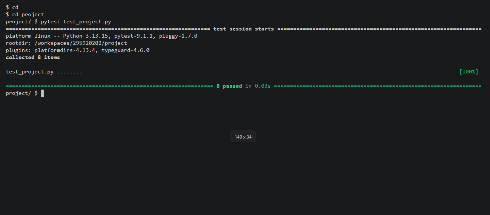

# Python Basics Quiz
## Demo

## What it does
This is a small command-line quiz game written in Python. When you run it, it asks five questions about Python basics, one at a time. You type an answer for each one. At the end, the program adds up how many answers were right, turns that into a percentage, and prints the percentage with a short message. The message changes with the score, from encouraging for a low score to celebratory for a perfect one.

The five questions are:
1. What is the capital of France?
2. What keyword stops a loop?
3. What function gives the length of a list?
4. What does .lower() do to text?
5. How many minutes are in an hour?

Answers are cleaned with `.strip()` and `.lower()`, so capital letters and extra spaces do not matter. For example, " Paris " still counts as correct.

## Files
- `project.py`: the program itself. It holds `main` and the helper functions.
- `test_project.py`: the tests, which run with pytest.
- `requirements.txt`: the libraries the project needs. Here it only lists pytest.
- `README.md`: this file.

## Functions
`main()` asks the five questions, keeps track of the score, and prints the final result. It is the only place where the program asks the user for input or prints the result.

`check_answer(i, j)` takes the answer the user gave and the correct answer. It returns `True` if they match and `False` if they do not.

`count(i, j)` uses `check_answer`. It returns 1 for a correct answer and 0 for a wrong one, so the points can be added up.

`percentage(total)` takes the number of correct answers out of questions present in QUESTIONS and returns the score as a whole number from 0 to 100, rounded with `round()`.

`message(x)` takes the percentage and returns a message for it. `message` works for any percent.

## How to run it
Start the quiz:

    python3 project.py

Run the tests:

    pytest test_project.py

## Design choices
I kept all the input and printing inside main(). The questions are asked in a loop over the QUESTIONS list. I made every other function take values in and return a value. A function like that is easy to test, because a test can call it with fixed values and check the answer. If `check_answer` asked for input itself, the tests would stop and wait for someone to type.

I split the work into small functions so that each one does one job. That made the code easier to read, and it made it easier to find a bug when a test failed. The tests cover a right answer, a wrong answer, the lowest and highest scores, and the messages.

The project has a limit. `percentage` gets the number of questions by reading the `QUESTIONS` list from outside the function, instead of receiving it as an argument. This makes it harder to test with different numbers of questions.
