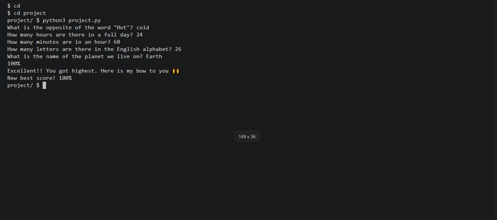

# Python Basics Quiz

## Demo

## What it does
This is a small command-line quiz game written in Python. When you run it, it reads a list of questions from a file called `questions.csv` and asks them one at a time. You type an answer for each one. At the end, the program counts the right answers, turns that into a percentage, and prints the percentage with a short message. The message changes with the score, from encouraging for a low score to celebratory for a perfect one.

Answers are cleaned with `.strip()` and `.lower()` before they are checked, so capital letters and extra spaces do not matter. For example, " Paris " still counts as correct. The answer has to match the one in the file exactly, so `lowercase` is right but `lower` is wrong.

## How to add a question
Open `questions.csv` and add a new line in this form:

    question,answer

Write the answer in lowercase. Do not put a comma inside the question. Do not change the first line, which must stay `question,answer`.

## Files
- `project.py`: the program itself. It holds `main` and the helper functions.
- `test_project.py`: the tests, which run with pytest.
- `questions.csv`: the questions and their answers.
- `requirements.txt`: the libraries the project needs. Here it only lists pytest.
- `README.md`: this file.
- `demo.png` and `test.png`: screenshots of the quiz and of the tests passing.

## Functions
`main()` loads the questions and asks each one. If `questions.csv` is missing, it stops with a clear message instead of crashing. It adds up the score and prints the result. It is the only place where the program asks for input or prints.

`load_questions(filename)` reads the CSV file with `csv.DictReader`. It returns a list of (question, answer) pairs.

`check_answer(i, j)` takes the answer the user gave and the correct answer. It returns `True` if they match and `False` if they do not.

`count(i, j)` uses `check_answer`. It returns 1 for a right answer and 0 for a wrong one, so the points can be added up.

`percentage(total, number)` takes the number of right answers and the number of questions. It returns the score as a whole number from 0 to 100.

`message(x)` takes the percentage and returns a message for it. It checks from the highest limit down (100, 80, 60, 40, 20), so it works for any percentage, not only for five questions.

## How to run it
Start the quiz:

    python3 project.py

Run the tests:

    pytest test_project.py

## Design choices
I kept all the input and printing inside `main()`, and I made every other function take values in and return a value. A function like that is easy to test, because a test can call it with fixed values and check the answer. If `check_answer` asked for input itself, the tests would stop and wait for someone to type.

I moved the questions out of the code and into `questions.csv`. Now a new question is one new line in a file, and no code has to change. `percentage` and `message` were changed to work for any number of questions, so adding a question does not break them.

The tests cover a right answer, a wrong answer, the score calculation, the messages, and loading questions from a CSV file. The file test uses a temporary file, so it never touches the real `questions.csv`.

## Limits and ideas for later
- Only one exact answer counts as right.
- Planned: ask 5 random questions from a bigger bank.
- Planned: save the best score between runs.

## Notes
I built this while learning Python. I used an AI assistant for guidance and to help draft this README. I wrote the code and the tests all by myself, and I can explain how each part works.
